# imfpythonbook


`imfpythonbook` is a small collection of helper functions for producing
publication-quality charts following the International Monetary Fund
(IMF) and World Economic Outlook (WEO) style guides. The package
provides two sets of utilities:

- **Matplotlib helpers** for configuring fonts, colors, themes, and axis
  tick behavior compatible with IMF and WEO charts.
- **Plotnine (ggplot-style) helpers** that mirror the look and feel of
  the same charts using the `plotnine` library.

The modules contained in this package were originally developed for the
IMF Python book and have been packaged here for reuse.

## Installation

Before installing this project, make sure you have the latest version of
`plotnine` installed:

``` sh
python -m pip install --upgrade "git+https://github.com/has2k1/plotnine.git"
```

Then install this package directly from GitHub:

``` sh
pip install git+https://github.com/BasBBakkerIMF/imfbookpython.git
```

## Quick start

For a first chart, see the standalone Matplotlib example in [IMF
charts](#imf-charts) below.

## IMF charts

### Matplotlib

Use `theme_imf` / `ip.matplotlib.set_imf_theme()` for standalone charts.
Use `theme_panel_imf` / `ip.matplotlib.set_imf_panel_theme()` for an
individual chart that sits inside a panel or multi-chart layout. The
panel variants use smaller headings and subheadings so titles and
subtitles fit cleanly within each chart without crowding the overall
layout.

#### Standalone chart

``` python
import numpy as np
import matplotlib.pyplot as plt
from IPython.display import display
import imfpythonbook as ip

ip.matplotlib.set_imf_theme()
x = np.linspace(0, 10, 100)
fig, ax = plt.subplots()
ip.matplotlib.set_titles(ax, "IMF Theme Example", "Subtitle")
ax.plot(x, np.sin(x), color=ip.colors.blue)
display(fig)
plt.close(fig)
```

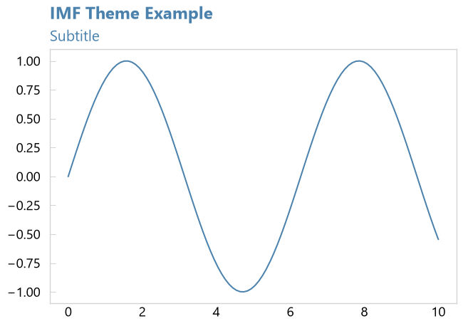

#### Panel chart

``` python
import matplotlib.pyplot as plt
from IPython.display import display
import imfpythonbook as ip

ip.matplotlib.set_imf_panel_theme()

fig, ax = plt.subplots()
ax.bar(
    ["A", "B", "C", "D"], [3, 1, 4, 2],
    color=[
        ip.colors.blue,
        ip.colors.green,
        ip.colors.red,
        ip.colors.grey,
    ],
)
ip.matplotlib.set_panel_titles(ax, "Panel Title", "Panel Subtitle")
display(fig)
plt.close(fig)
```

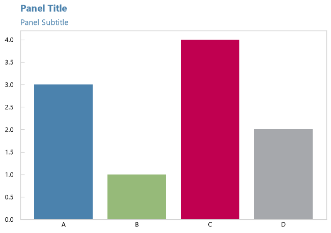

#### 2027 themes

``` python
import matplotlib.pyplot as plt
from IPython.display import display
import imfpythonbook as ip

ip.matplotlib.set_imf_2027_theme()
fig, ax = plt.subplots()
ax.bar(
    ["A", "B", "C", "D"], [3, 1, 4, 2],
    color=[ip.colors.blue_2027, ip.colors.green, ip.colors.red, ip.colors.grey]
)
ip.matplotlib.set_titles(ax, "IMF 2027 Theme", "Subtitle")
display(fig)
plt.close(fig)

ip.matplotlib.set_imf_panel_2027_theme()
fig, ax = plt.subplots()
ax.bar(
    ["A", "B", "C", "D"], [3, 1, 4, 2],
    color=[
        ip.colors.blue_2027,
        ip.colors.green,
        ip.colors.red,
        ip.colors.grey,
    ],
)
ip.matplotlib.set_panel_titles(ax, "IMF 2027 Panel Theme", "Subtitle")
display(fig)
plt.close(fig)
```

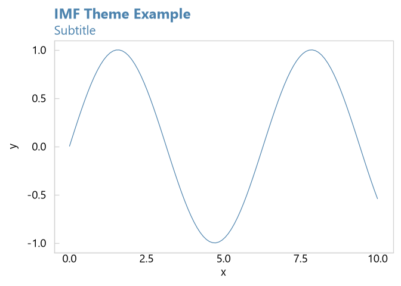

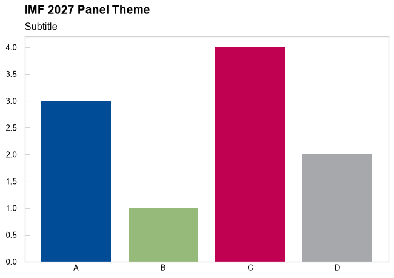

### Plotnine

The same distinction applies to the Plotnine helpers: use `theme_imf` /
`ip.plotnine.set_imf_theme()` for standalone charts and
`theme_panel_imf` / `ip.plotnine.set_imf_panel_theme()` for charts that
are one panel in a larger layout. The panel versions use smaller
headings and subheadings to keep each panel readable.

#### Standalone chart

``` python
import numpy as np
import pandas as pd
from plotnine import ggplot, aes, geom_line
import imfpythonbook as ip

x = np.linspace(0, 10, 100)
df = pd.DataFrame({"x": x, "y": np.sin(x)})
p = (
    ggplot(df, aes("x", "y"))
    + geom_line(color=ip.colors.blue)
    + ip.plotnine.set_imf_theme()
)
for layer in ip.plotnine.set_titles("IMF Theme Example", "Subtitle"):
    p += layer
p.show()
```

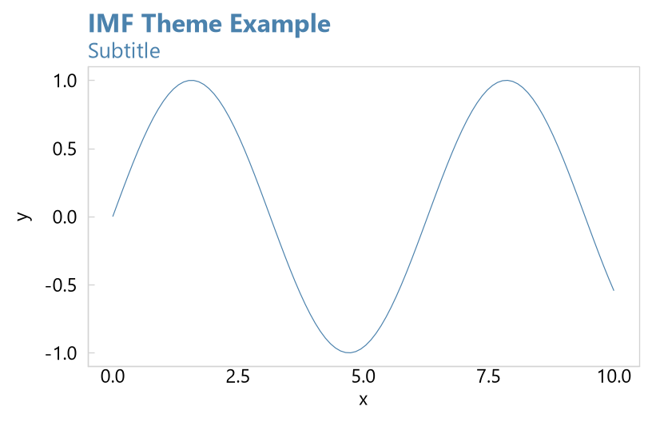

#### Panel chart

``` python
import pandas as pd
from plotnine import ggplot, aes, geom_bar, scale_fill_manual
import imfpythonbook as ip

df = pd.DataFrame({"category": ["A", "B", "C", "D"], "value": [3, 1, 4, 2]})
p = (
    ggplot(df, aes("category", "value", fill="category"))
    + geom_bar(stat="identity")
    + scale_fill_manual(values=[
        ip.colors.blue, ip.colors.green, ip.colors.red, ip.colors.grey
    ])
    + ip.plotnine.set_imf_panel_theme()
)
for layer in ip.plotnine.set_panel_titles("Panel Title", "Panel Subtitle"):
    p += layer
p.show()
```

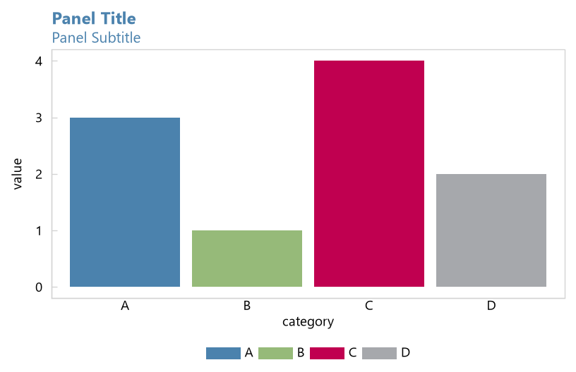

#### 2027 themes

Use the 2027 variants for the Arial-based theme and updated IMF blue:

``` python
import numpy as np
import pandas as pd
from plotnine import ggplot, aes, geom_line
import imfpythonbook as ip

x = np.linspace(0, 10, 100)
df = pd.DataFrame({"x": x, "y": np.sin(x)})
p = (
    ggplot(df, aes("x", "y"))
    + geom_line(color=ip.colors.blue_2027)
    + ip.plotnine.set_imf_2027_theme()
)
for layer in ip.plotnine.set_titles("IMF 2027 Theme", "Subtitle"):
    p += layer
p.show()
```

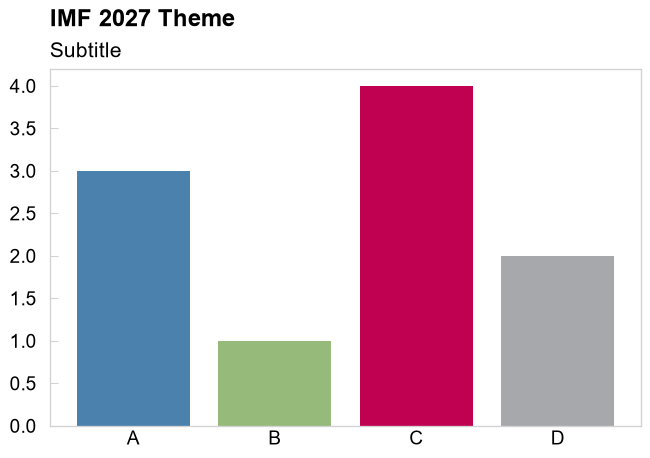

Use `ip.plotnine.set_imf_panel_2027_theme()` for panel plots and
`ip.plotnine.set_imf_panel_title_2027_theme()` for an overall panel
title. Plotnine IMF themes use larger text for readability, while panel
themes use smaller text so labels and legends fit within each chart in a
multi-chart layout. Standard and panel themes default to an
8.5-by-5.5-inch figure. Set `figure_size=(width, height)` to customize
the dimensions.

#### Multi-chart panels

For multi-chart layouts, compose Plotnine charts with `|` and `/` and
use `plot_annotation()` for a shared title and subtitle. These examples
use explicit color scales to match the R package’s `scale_imf_colors()`
helpers. When running the examples sequentially as a Windows script with
the TkAgg backend, closing earlier plot windows can leave a stale
toolbar callback. For rendering these compositions without opening GUI
windows, select the non-interactive Agg backend and display the rendered
images inline:

Create reproducible data for both panel examples:

``` python
from io import BytesIO
import matplotlib
matplotlib.use("Agg")
from IPython.display import Image, display

import numpy as np
import pandas as pd

rng = np.random.default_rng(123)
panel_data = pd.DataFrame({
    "dates": pd.date_range("2020-01-01", periods=12, freq="MS"),
    "category": np.repeat(["A", "B", "C"], 4),
    "value1": rng.uniform(50, 100, 12),
    "value2": rng.uniform(20, 80, 12),
})
```

Original IMF colors and panel theme:

``` python
from plotnine import (
    aes, geom_bar, geom_line, geom_point, ggplot, labs,
    scale_color_manual, scale_fill_manual, scale_x_datetime, theme,
)
from plotnine.composition import plot_annotation
import imfpythonbook as ip

panel_colors = [ip.colors.blue, ip.colors.green, ip.colors.red]

p1 = (
    ggplot(panel_data, aes("dates", "value1", color="category"))
    + geom_line(size=1.5)
    + scale_x_datetime(date_breaks="2 months", date_labels="%b\n%Y")
    + scale_color_manual(values=panel_colors)
    + labs(title="IMF Line Chart", subtitle="IMF palette")
    + ip.plotnine.set_imf_panel_theme()
)

p2 = (
    ggplot(panel_data, aes("dates", "value1", fill="category"))
    + geom_bar(stat="identity", position="stack")
    + scale_x_datetime(date_breaks="2 months", date_labels="%b\n%Y")
    + scale_fill_manual(values=panel_colors)
    + labs(title="IMF Stacked Bar", subtitle="IMF palette")
    + ip.plotnine.set_imf_panel_theme()
)

p3 = (
    ggplot(panel_data, aes("value1", "value2", color="category"))
    + geom_point(size=3)
    + scale_color_manual(values=panel_colors)
    + labs(title="IMF Scatter", subtitle="IMF palette")
    + ip.plotnine.set_imf_panel_theme()
)

composition = (
    (p1 | p2) / p3
    + plot_annotation(
        title="Panel Test: theme_imf_panel()",
        subtitle="Multiple plots in a panel layout",
        theme=(
            ip.plotnine.set_imf_panel_title_theme()
            + theme(figure_size=(13, 11))
        ),
    )
)
image = BytesIO()
composition.draw().savefig(image, format="png", dpi=150, bbox_inches="tight")
display(Image(data=image.getvalue()))
```

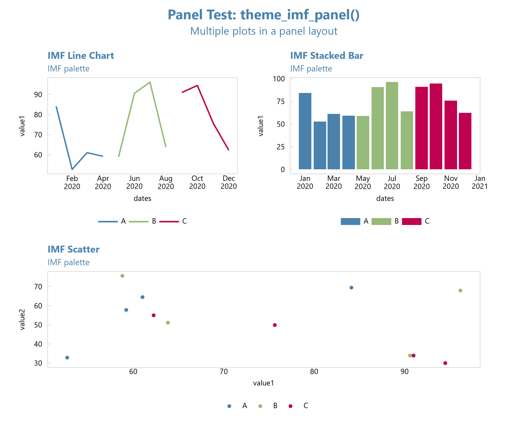

The 2027 panel theme uses the updated IMF blue:

``` python
panel_colors_2027 = [
    ip.colors.blue_2027,
    ip.colors.green,
    ip.colors.red,
]

p1_2027 = (
    ggplot(panel_data, aes("dates", "value1", color="category"))
    + geom_line(size=1.5)
    + scale_x_datetime(date_breaks="2 months", date_labels="%b\n%Y")
    + scale_color_manual(values=panel_colors_2027)
    + labs(title="IMF Line Chart", subtitle="IMF palette")
    + ip.plotnine.set_imf_panel_2027_theme()
)

p2_2027 = (
    ggplot(panel_data, aes("dates", "value1", fill="category"))
    + geom_bar(stat="identity", position="stack")
    + scale_x_datetime(date_breaks="2 months", date_labels="%b\n%Y")
    + scale_fill_manual(values=panel_colors_2027)
    + labs(title="IMF Stacked Bar", subtitle="IMF palette")
    + ip.plotnine.set_imf_panel_2027_theme()
)

p3_2027 = (
    ggplot(panel_data, aes("value1", "value2", color="category"))
    + geom_point(size=3)
    + scale_color_manual(values=panel_colors_2027)
    + labs(title="IMF Scatter", subtitle="IMF palette")
    + ip.plotnine.set_imf_panel_2027_theme()
)

composition_2027 = (
    (p1_2027 | p2_2027) / p3_2027
    + plot_annotation(
        title="Panel Test: theme_imf_panel_2027()",
        subtitle="Multiple plots in a panel layout",
        theme=(
            ip.plotnine.set_imf_panel_title_2027_theme()
            + theme(figure_size=(13, 11))
        ),
    )
)
image_2027 = BytesIO()
composition_2027.draw().savefig(
    image_2027, format="png", dpi=150, bbox_inches="tight"
)
display(Image(data=image_2027.getvalue()))
```

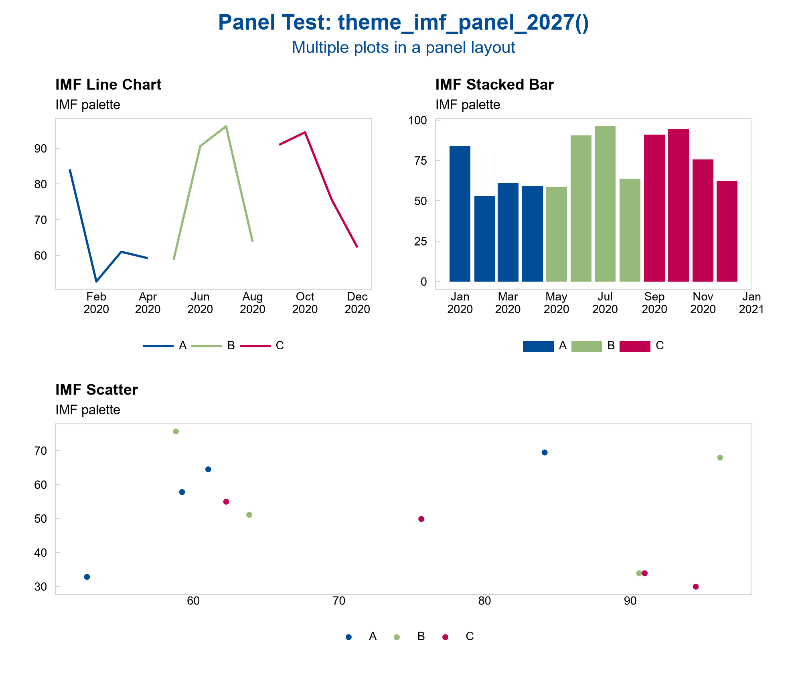

------------------------------------------------------------------------

## WEO-Styled Examples

> These examples use the WEO modules directly (unchanged API).

### WEO-Styled Unemployment Chart (Matplotlib)

``` python
import numpy as np, matplotlib.pyplot as plt
from IPython.display import display
from imfpythonbook.WEO_matplotlib import (
    set_weo_theme, add_y_ticks, add_x_end_ticks,
    add_weo_title, generate_breaks_auto, weo_colors, weo_text_size
)

set_weo_theme()
years = np.arange(2000, 2026)
countries = ["BRA", "CHL", "COL", "MEX", "PER"]
data = {c: np.random.randn(len(years)).cumsum() for c in countries}
breaks = generate_breaks_auto(np.concatenate(list(data.values())))

fig, ax = plt.subplots(figsize=(8, 4), dpi=100)
for i, country in enumerate(countries):
    ax.plot(years, data[country], label=country, color=weo_colors[i])

ax.set_xticks(years[::5]); ax.set_xlim(years.min(), years.max())
ax.set_yticks(breaks['major']); ax.set_ylim(breaks['limits'])

add_y_ticks(ax, breaks['major'], breaks['minor'], years.min(), years.max())
add_x_end_ticks(ax, years.min(), years.max())
add_weo_title(ax, "Figure 1.2. Unemployment Rate Change", "(Percentage point change, annual data)")
display(fig)
plt.close(fig)
```

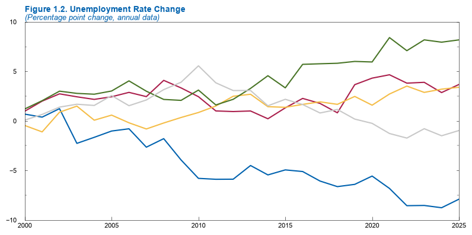

### WEO-Styled Real GDP Panel (Plotnine)

``` python
import numpy as np, pandas as pd
from plotnine import ggplot, aes, geom_line, facet_wrap, scale_y_continuous, ggtitle, labs
from imfpythonbook.WEO_plotnine import (
    set_weo_panel_theme_plotnine, generate_breaks_auto,
    add_forecast_shading_plotnine, blue
)

years = list(range(2000, 2026))
countries = ["BRA", "CHL", "COL", "MEX"]
df = []

for country in countries:
    growth = np.random.normal(0.02, 0.01, len(years))
    index = 100 * np.cumprod(1 + growth)
    df.append(pd.DataFrame({"year": years, "value": index, "country": country}))

df = pd.concat(df)
breaks = generate_breaks_auto(df["value"])

p = (
    ggplot(df, aes("year", "value"))
    + geom_line(color=blue, size=1.1)
    + facet_wrap("~country")
    + scale_y_continuous(breaks=breaks["major"], limits=breaks["limits"])
    + set_weo_panel_theme_plotnine(figure_size=(16, 14.67))
    + add_forecast_shading_plotnine(start_year=2022, end_year=2025, y_range=breaks["limits"])
    + ggtitle("Figure X. Real GDP Panel, Plotnine Example")
    + labs(subtitle="(Index, 2010=100)", caption="Source: Synthetic data. Real GDP index rebased to 2010=100.")
)

p.show()
```

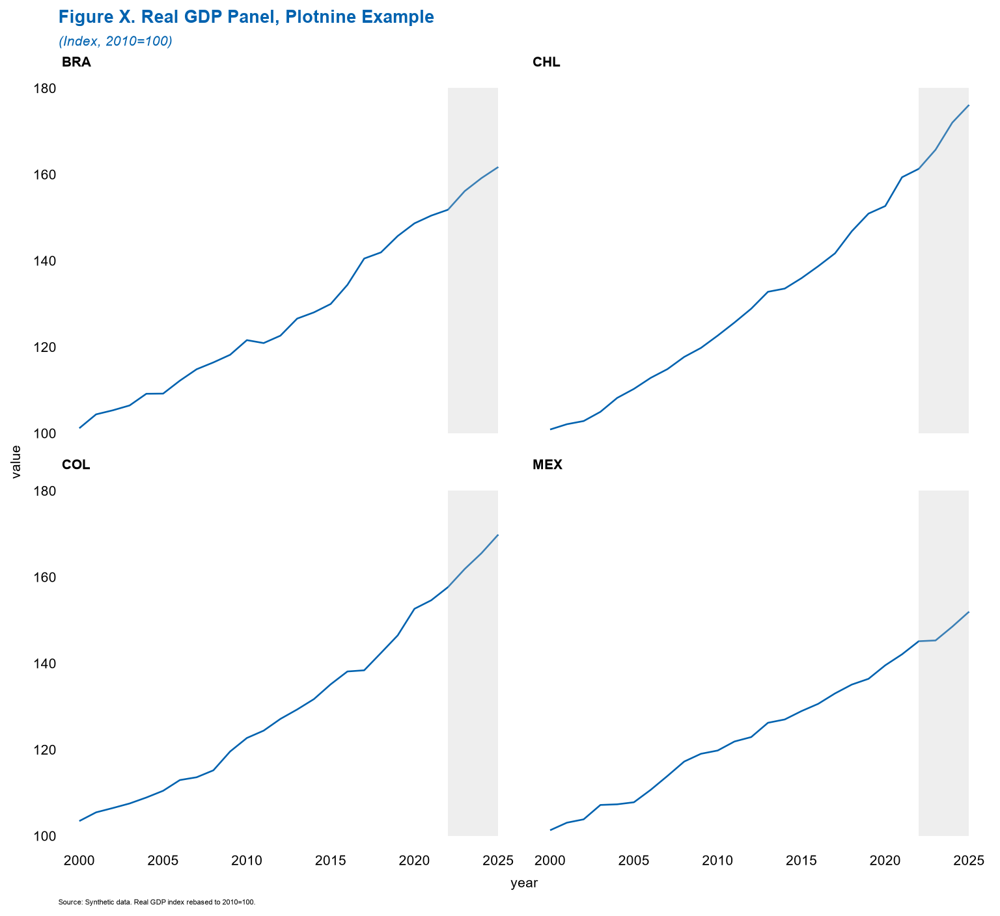
